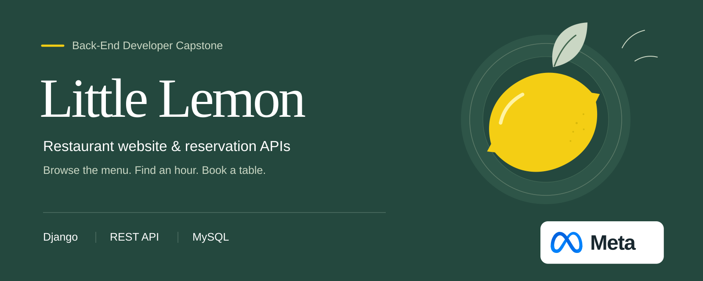
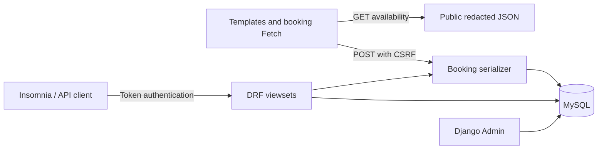

# Little Lemon — Meta Back-End Developer Capstone

Browse a restaurant menu, reserve an available hour, and manage menu items and bookings through a Django REST API.

The website reads its menu from MySQL and uses Fetch to refresh availability and submit reservations. A database constraint protects each date and time slot, while staff permissions protect customer records and menu changes. The restaurant and its menu are fictional demonstration content.

[Run the project](#-installation) · [Endpoint reference](Readme.txt) · [Insomnia collection](docs/insomnia.json)

##  Features

- Responsive home, about, menu, item detail, booking, and reservation pages with repository-local illustrations.
- Interactive booking with date filtering, unavailable-hour detection, inline feedback, and backend duplicate prevention.
- Menu and category APIs with searching, ordering, filtering, pagination, and staff-controlled writes.
- Public reservation creation; staff-controlled reservation browsing, updates, and deletion.
- User registration, hashed passwords, token login/logout, Django Admin, and executable behavior tests.

##  Installation

Requires Python 3.14, Pipenv, and MySQL 8 (the development container uses MySQL 8.4). Building `mysqlclient` requires compiler tools, `pkg-config`, Python development headers, and MySQL client headers. On Debian/Ubuntu, install `build-essential pkg-config python3-dev default-libmysqlclient-dev`; use equivalent packages on other systems.

From the extracted repository directory:

```bash
python -m pip install --user pipenv
pipenv sync --dev
cp .env.example .env
```

Edit `.env`: replace `DJANGO_SECRET_KEY` with a long random value, set your local database password, and retain `DJANGO_DEBUG=True` for the local HTTP development server. Generate a secret with:

```bash
python -c 'import secrets; print(secrets.token_urlsafe(64))'
```

Create a database and an application user in MySQL, substituting your own password locally:

```sql
CREATE DATABASE littlelemon CHARACTER SET utf8mb4;
CREATE USER 'littlelemon'@'%' IDENTIFIED BY 'replace-with-your-local-password';
GRANT ALL PRIVILEGES ON littlelemon.* TO 'littlelemon'@'%';
```

Set `DB_NAME`, `DB_USER`, `DB_PASSWORD`, `DB_HOST`, and `DB_PORT` in `.env` to match that database. For a local-only MySQL installation, restrict the user host to the actual connecting host instead of `%` where possible. Never commit `.env`.

```bash
pipenv run python manage.py migrate
pipenv run python manage.py seed_menu
pipenv run python manage.py createsuperuser
```

Committed migrations are sufficient for setup. After intentionally changing a model, create and inspect a new migration with `pipenv run python manage.py makemigrations restaurant`, then apply it with `migrate`.

### Docker Compose alternative

With Docker Engine and the Compose plugin, configure `.env` as above and set a separate `MYSQL_ROOT_PASSWORD`. Compose creates the database and application user; skip the manual SQL setup for this path.

```bash
docker compose up -d db
docker compose run --rm web python manage.py migrate
docker compose run --rm web python manage.py seed_menu
docker compose run --rm web python manage.py createsuperuser
docker compose up web
```

Open <http://127.0.0.1:8000/>. Stop with Ctrl+C and `docker compose down`; the named MySQL volume retains your data. Use `docker compose down -v` only when you intend to delete that local database. Compose exposes MySQL and Django only on loopback. It is a development setup.

##  Quick start

```bash
pipenv run python manage.py runserver
```

Open <http://127.0.0.1:8000/>. Browse `/menu/`, choose **Book a table**, select an available hour, enter a name, and reserve it. The hour becomes unavailable without a page reload. `/reservations/` shows availability for a chosen date and every booking as JSON. Open `/reservations/?format=json` for the complete JSON response. Stop the development server with Ctrl+C.

```bash
curl http://127.0.0.1:8000/api/menu-items/
```

The response contains `count`, `next`, `previous`, and a `results` list of seeded menu items.

##  API reference

[Readme.txt](Readme.txt) documents every route, method, permission, response, and an Insomnia testing sequence. Import [docs/insomnia.json](docs/insomnia.json) to try the requests with `base_url`, `token`, `menu_item_id`, `booking_id`, `category_id`, and `reservation_date` environment variables.

| Route | Methods | Access |
| --- | --- | --- |
| `/api/menu-items/` | GET, POST | Public read; staff create |
| `/api/menu-items/{id}/` | GET, PUT, PATCH, DELETE | Public read; staff changes |
| `/api/categories/` | GET, POST | Public read; staff create |
| `/api/categories/{id}/` | GET, PUT, PATCH, DELETE | Public read; staff changes |
| `/api/bookings/` | GET, POST | Staff list; public create |
| `/api/bookings/{id}/` | GET, PUT, PATCH, DELETE | Staff only |
| `/bookings?date=YYYY-MM-DD` | GET | Public redacted availability |
| `/reservations/?format=json` | GET | All dates; names redacted for public visitors |
| `/auth/users/` | POST | Public registration |
| `/auth/token/login/` | POST | Public login |
| `/auth/token/logout/` | POST | Authenticated |
| `/auth/users/me/` | GET | Authenticated |

Authenticate with `Authorization: Token <authentication-token>`. Registration never grants staff access. Create a superuser through the terminal or assign `is_staff` through Django Admin using an authorized administrator.

Menu queries support `category` (ID or slug), `featured=true`, `search`, `ordering=price` (prefix `-` for descending), and `page`. Booking API staff lists support `date=YYYY-MM-DD`. The public compatibility route requires `date` and returns a bare JSON array with `first_name` set to `Reserved`; staff signed into the Django website can see actual names. Token authentication is used for `/api/` routes, not this Django compatibility route.

##  Architecture

Django templates render database-backed pages. The booking script fetches public availability and submits JSON to the CSRF-protected `/book/` view. Both the website and REST API validate bookings through the same serializer; MySQL enforces the date/slot uniqueness constraint even if requests race.



`littlelemon/` owns settings and root routing. `restaurant/` owns models, serializers, access rules, views, migrations, seeding, and tests. `templates/` and `static/` contain the interface; `Readme.txt` and `docs/` contain the reviewer's API reference.

##  Verification

```bash
pipenv run python manage.py check
pipenv run python manage.py makemigrations --check --dry-run
pipenv run python manage.py test
node --test scripts/booking.test.cjs
```

Django's MySQL test runner creates a separate `test_littlelemon` database. Use a development-only database account with permission to create and drop that test database; do not grant those permissions to a production account. In the local MySQL root client:

```sql
GRANT ALL PRIVILEGES ON test_littlelemon.* TO 'littlelemon'@'%';
```

The user host must match the user created during installation. To run the explicitly separate SQLite test configuration without MySQL:

```bash
pipenv run python manage.py test --settings=littlelemon.test_settings
```

The JavaScript tests require Node.js 18+ and execute the booking script with simulated DOM and Fetch fixtures. With the development server running against the same configured database, `pipenv run python scripts/smoke_http.py` exercises real HTTP requests and cleans up its temporary records. It refuses production-mode settings.

Tests exercise website rendering, full menu/booking CRUD, role boundaries, date filtering, JSON redaction, invalid inputs and IDs, database uniqueness, registration, token revocation, and the website's CSRF boundary. SQLite tests do not verify a MySQL connection. See [docs/verification.md](docs/verification.md) for execution evidence recorded during delivery and [the booking assignment audit](docs/booking-assignment.md) for all 13 reservation requirements.

##  Security and limitations

Reservations use one booking per hour from 10 AM through 8 PM in `America/Chicago`; this capstone does not model multiple tables or party sizes. Past dates and already-started hours are rejected. Public availability redacts names; complete records are restricted to staff. Public booking creation does not require an account and is rate-limited at the API layer.

This is a local development and peer-review application. Before public hosting, provision HTTPS, production static-file serving, backups, database access controls, monitoring, and appropriate abuse prevention. Production settings disable debug and enable secure cookies and HTTPS redirects; configure valid hosts and a private secret. The development server is not a production deployment.

Technical references: [Django MySQL backend](https://docs.djangoproject.com/en/5.2/ref/databases/#mysql-notes), [Djoser token endpoints](https://djoser.readthedocs.io/en/latest/token_endpoints.html), and [DRF token authentication](https://www.django-rest-framework.org/api-guide/authentication/#tokenauthentication).

> 
>
> Guided project from the **Meta Back-End Developer Professional Certificate**, taught by **Meta Experts**. The curriculum provides the Little Lemon project brief; Abdulrahman M. Yaqyn maintains this implementation and its verification.
